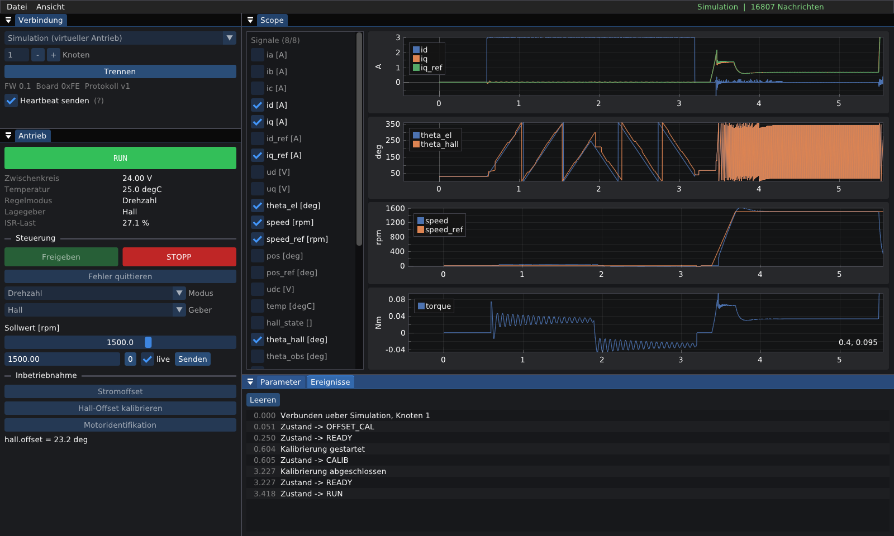

# FOC-Framework (CarPediem, 4. Generation)

Ausbau der CarPediem-Firmware (Masterarbeit Akgül 2023) zu einem wiederverwendbaren FOC-Framework für den F28388D-Frequenzumrichter. Ziel sind Drehzahl- und Lageregelung mit Hall, sensorlos oder hybrid.

Dieser Stand enthält den **Kommunikationskern** und das **Host-Tool**:

| Ordner | Inhalt |
|---|---|
| `protocol/` | **FOCP** – Antriebsprotokoll in C99, wird von Firmware und Host gemeinsam genutzt. Parameter- und Signaltabellen sind die einzige Quelle (`*.def`). |
| `firmware/` | `focp_target.c/.h` – Anbindung für das Simulink-Modell (C-Caller-Blöcke / Custom Code, C28x) |
| `host/core/` | C++17-Bibliothek: Transporte (Simulation, SocketCAN, PCAN), `Device` (Parameter-Cache, Telemetrie), `VirtualDrive` |
| `host/app/` | **FOC Studio** – native GUI (Dear ImGui + ImPlot, GLFW, OpenGL 3) |
| `host/tests/` | Protokoll-, Regelkreis- und Integrationstests |
| `matlab/` | **Modellbasierte Firmware**: Parameter-Skripte (statt `.mat`), Reglerauslegung, Build-Skripte für Simulink-Bibliothek und Anwendungsmodell, Tests. Anleitung: `docs/P0_P1_Anleitung.md` |
| `docs/` | Konzept/Roadmap, Analyse der Vorgänger-Firmware und -Hardware, Anleitung P0/P1 |



## Bauen

Voraussetzungen: CMake ≥ 3.20, ein C++17-Compiler und Git. ImGui, ImPlot und (falls nicht installiert) GLFW lädt CMake beim ersten Konfigurieren selbst herunter.

```bash
cmake -S . -B build            # Linux: zusätzlich -G Ninja möglich
cmake --build build --config Release
ctest --test-dir build -C Release --output-on-failure
```

- **Windows (Visual Studio 2022):** genauso. Die Exe liegt unter `build/host/app/Release/focstudio.exe`. Für PCAN muss der PEAK-Treiber installiert sein (liefert `PCANBasic.dll`).
- **Linux:** `libglfw3-dev` und `libgl1-mesa-dev` installieren oder GLFW automatisch laden lassen. Für CAN entweder SocketCAN (`sudo ip link set can0 up type can bitrate 500000`) oder PEAK PCAN-Basic für Linux verwenden.
- **Qt-Oberfläche (`focstudio`, in Arbeit):** braucht Qt 6 (Windows: MSVC 2022 64-bit). Beim Konfigurieren `-DCMAKE_PREFIX_PATH=C:/Qt/6.12.0/msvc2022_64` angeben; zum Starten muss `C:\Qt\6.12.0\msvc2022_64\bin` im `PATH` liegen. Qwt lädt CMake selbst. Die bisherige ImGui-Oberfläche heißt jetzt `focstudio-dev` (`-DFOC_BUILD_DEV_GUI=OFF` schaltet sie ab).
- Ohne GUI (z. B. CI): `-DFOC_BUILD_GUI=OFF -DFOC_BUILD_DEV_GUI=OFF`

## FOC Studio

```bash
./build/host/app/focstudio            # normal
./build/host/app/focstudio --demo     # virtueller Antrieb + Demo-Ablauf
```

- **Verbindung:** Simulation, SocketCAN oder PCAN-USB, Knoten 0–15. Das Tool sendet einen Heartbeat. Bleibt er im Betrieb länger als `comm.timeout_ms` aus, schaltet der Antrieb mit Fehler COMM ab.
- **Antrieb:** Zustand, Fehler, Freigabe/STOPP/Quittieren, Regelmodus (Moment, Drehzahl, Lage, Open-Loop I/f), Geber (Hall, sensorlos, hybrid), Sollwert (live), Kalibrierungen.
- **Scope:** bis zu 8 Signale gleichzeitig, Abtastung = f_PWM / Teiler, Plots nach Einheit gruppiert, Pause, CSV-Export.
- **Parameter:** alle Parameter mit Bereich und Beschreibung. Abgelehnte Schreibversuche werden rot markiert. Motorparameter (`FOCP_F_LOCK`) sind nur im Stillstand änderbar.
- **Ereignisse:** Zustandswechsel, Fehler, Kalibrierergebnisse.

Der **virtuelle Antrieb** führt denselben C-Protokollcode aus wie das Target. Dahinter hängen ein PMSM-dq-Modell (ECI 63.60), ein idealer Wechselrichter mit Spannungsgrenze, Hall-Emulation (Montageversatz 23°, optional Fehlflanken über `sim.hall_noise`), ein vereinfachter Beobachter, die Regelkaskade und der Supervisor. Damit lassen sich GUI und Regelstrategie ohne Hardware entwickeln.

## Protokoll FOCP (Kurzfassung)

Jede Nachricht hat höchstens 8 Byte Nutzdaten und entspricht damit genau einem CAN-Frame. Für UART und TCP wird dieselbe Nachricht mit COBS und CRC-16 gerahmt (`focp_frame.h`).

| fn | CAN-ID (Knoten n) | Richtung | Inhalt |
|---|---|---|---|
| 0x20 CMD | 0x200+n | Host → Antrieb | Freigabe, Stopp, Quittieren, Sollwert, Kalibrierung, Telemetrie-Konfiguration, Heartbeat … |
| 0x21 PARAM_REQ | 0x210+n | Host → Antrieb | Parameter lesen/schreiben (ID 16 bit, Wert float32) |
| 0x22 PARAM_RSP | 0x220+n | Antrieb → Host | Status + aktueller Wert |
| 0x23 STATUS | 0x230+n | Antrieb → Host | Zustand, Modus, Geber, Fehlerbits, Udc, Temperatur (10 Hz) |
| 0x24 TELEM | 0x240+n | Antrieb → Host | Folgenummer, Slot, 3 × int16 (skaliert laut Signaltabelle) |
| 0x25 EVENT | 0x250+n | Antrieb → Host | Fehler gesetzt/quittiert, Zustand, Kalibrierung |
| 0x26 INFO | 0x260+n | Antrieb → Host | Protokoll-/FW-Version, Tabellengrößen |

Der Bereich 0x200–0x26F kollidiert nicht mit den alten CarPediem-IDs (0x101/0x102/0x110/0x111).

**Neuen Parameter oder neues Signal anlegen:** eine Zeile in `protocol/include/focp/focp_params.def` bzw. `focp_signals.def` ergänzen und Firmware und Tool neu bauen. Eine einmal vergebene ID wird nie wiederverwendet. Weichen die Tabellen von Antrieb und Tool voneinander ab, meldet das Tool das nach dem Verbinden.

**C28x:** Auf dem C28x ist `CHAR_BIT` 16. Deshalb steht jedes Byte in einem eigenen `focp_byte_t` (`uint_least8_t`), und auf den Bus geht alles nur über die Pack-Funktionen, nie per `memcpy` auf Structs.

## Firmware-Anbindung (nächster Schritt, Phase P1)

In der Simulink-Konfiguration unter *Code Generation → Custom Code* `protocol/include` und `firmware` als Include-Pfade eintragen. Als Quellen kommen `protocol/src/focp.c`, `protocol/src/focp_dev.c` und `firmware/focp_target.c` dazu. Aufrufe über C-Caller-Blöcke:

| Rate | Aufruf |
|---|---|
| Init | `focp_target_init(node)` |
| eCAN RX | `focp_target_rx_can(id, data, len)` |
| Hintergrund | `focp_target_tx_pop(...)` → eCAN TX, `focp_target_cmd_take(...)` → Supervisor |
| Strom-ISR | `focp_target_set_signal(...)`, `focp_target_sample()` |
| 1 ms | `focp_target_tick_1ms()` → Fehler COMM |
| 100 ms | `focp_target_status(...)` |
| überall | `focp_target_param(FOCP_P_...)` statt Workspace-Konstanten |

Die Anbindung ist auf dem Host kompiliert und getestet, auf dem C28x aber noch nicht gelaufen. Für den C28x müssen `focp_target_irq_save/restore` umgesetzt werden (siehe Kommentar in `focp_target.c`).

## Was die Simulation bisher gezeigt hat

Die folgenden Punkte gelten auch für die echte Hardware und müssen in der Firmware so umgesetzt werden:

1. **Drehzahlregler mit Hall:** Bei 200 min⁻¹ kommt nur alle 12,5 ms eine Hall-Flanke. 20 Hz Bandbreite (Auslegung aus der Masterarbeit) machen den Kreis instabil, deshalb ist der Default jetzt 5 Hz. Bei großer Last- bzw. Fahrzeugträgheit muss neu ausgelegt werden.
2. **Hall-Drehzahl im Regelkreis:** Ist die nächste Flanke überfällig, wird 60°/(Zeit seit Flanke) als abklingende Obergrenze verwendet, statt den alten Wert zu halten.
3. **Kaskade:** Der Lageregler muss deutlich langsamer sein als der Drehzahlregler (Default 1 Hz gegenüber 5 Hz).
4. **Lage mit Hall:** Die Auflösung ist 15° mechanisch. Ohne Totband pendelt die Regelung ±20°, weil der Hall-Geber eine Richtungsumkehr innerhalb eines Sektors nicht erkennt. Das Totband muss größer sein als eine halbe Hall-Stufe (`pos.deadband` = 8°). Damit steht die Achse mit < 7,5° Abweichung. Für echte Servoanwendungen braucht es einen Encoder.
5. **Hall-Kalibrierung:** Reibung erzeugt einen Lastwinkel, deshalb liefert eine Messung in nur einer Richtung den halben Offset (11,5° statt 23°). Das Verfahren misst vorwärts und rückwärts und mittelt (Ergebnis 23,2°).
6. **Motordaten:** Aus Ke (4,26 V/krpm) folgt Ψ ≈ 0,0083 Vs. `params_f280049c.mat` enthält 0,038 Vs, `params_f2838.mat` 0,00069 Vs. Das wird mit der Motoridentifikation (P4) geklärt.

## Stand

| Funktion | Status |
|---|---|
| Protokoll, Framing, Geräteseite | getestet (Host) |
| Firmware-Anbindung `focp_target` | auf dem Host getestet, C28x offen |
| Virtueller Antrieb: Hall, sensorlos, hybrid, Lage, Schutzfunktionen, Hall-Kalibrierung | getestet |
| FOC Studio mit Simulation | läuft |
| SocketCAN | implementiert, ohne Hardware nicht getestet |
| PCAN-Basic | implementiert, ohne Hardware nicht getestet |
| UART/TCP-Transport (für den CM-Core) | Framing fertig, Transport offen |
| Motoridentifikation | offen (P4) |
