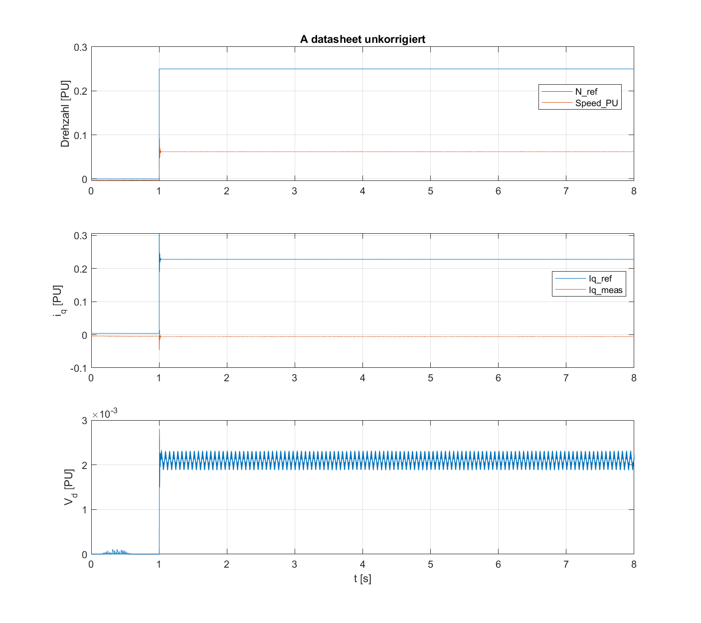
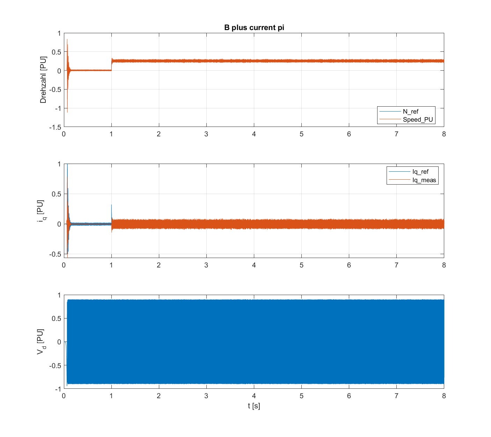
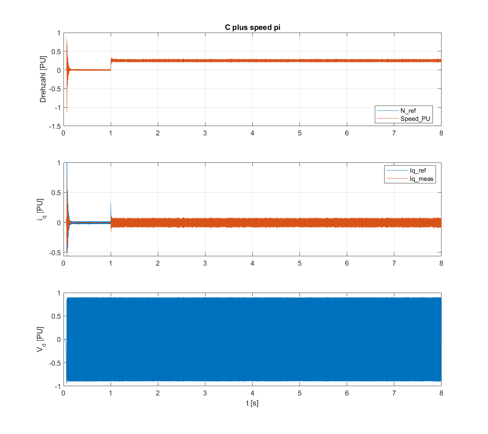

# Schritt 5 – P1b: Reglerkorrekturen in Simulation (2026-11-03)

## Ablauf

| Schritt | Befehl | Ergebnis |
|---|---|---|
| Ausgangsstand | `git diff --stat P1a -- matlab/models/focLib.slx` | leer (focLib = P1a, alle PID `UseKiTs = on`) |
| Probelauf | `foc_startup('datasheet'); T = foc_run_p1b(2)` | EXIT 0 (Log `05_probelauf.log`, Kennzahlen `P1b_Kennzahlen_probelauf_2s.csv`) |
| Zurücksetzen | `git checkout P1a -- matlab/models/focLib.slx` | Diff leer |
| Vollständiger Lauf | `foc_startup('datasheet'); T = foc_run_p1b` (StopTime 8 s) | EXIT 0 (Log `05_P1b_lauf.log`) |
| Diagnose (nur lesen) | Reglerparameter + Signalstatistik aus `P1b_Vergleich.mldatx` | Log `05_diagnose.log` |

`foc_apply_fixes` hat vorher und nachher protokolliert, wie erwartet:
- Id/Iq: `P = Kp − 0,0002`, `I = Ki_(d_)texas*Ts`, `UseKiTs = on`, [0, 1] → `P = Kp`, `I = Ki_i(d)`, `UseKiTs = off`, [−1, 1]
- Speed: `I = Ki_speed_texas*Ts_speed`, `UseKiTs = on` → `I = Ki_speed`, `UseKiTs = off`, Grenzen [−0,5, 1] unverändert

## Kennzahlen (8 s, Auswertung der letzten 20 % = 6,4…8 s, `vd_min` über den ganzen Lauf)

| Lauf | speed_err_mean | iq_err_rms | id_err_rms | vd_min |
|---|---|---|---|---|
| A datasheet, unkorrigiert | 0,18815 | 0,23334 | 0,00974 | 0 |
| B + current_pi | −0,00372 | 0,07399 | **0,23506** | −0,9429 |
| C + speed_pi | −0,000004 | 0,07312 | **0,23474** | −0,94282 |

Der 2-s-Probelauf liefert praktisch dieselben Werte. Der Effekt hängt also nicht vom Auswertefenster ab.

## Plots

| A | B | C |
|---|---|---|
|  |  |  |

## Zusatzdiagnose (nur gelesen, letzte 20 %)

| Lauf | Signal | Mittel | Std | Min | Max | Nulldurchgänge → f |
|---|---|---|---|---|---|---|
| A | V_d | 0,0021 | 0,0001 | 0,0019 | 0,0023 | ~253 Hz (Welligkeit) |
| A | i_d | −0,0097 | 0,0005 | −0,0108 | −0,0087 | |
| B | V_d | −0,032 | **0,810** | −0,903 | 0,905 | **~326 Hz** |
| B | i_d | 0,000 | **0,235** | −0,430 | 0,420 | ~326 Hz |
| C | V_d | −0,032 | 0,810 | −0,903 | 0,905 | ~325 Hz |
| C | i_d | 0,000 | 0,235 | −0,431 | 0,420 | ~325 Hz |

i_d,ref ist in allen Läufen 0. Reglerwerte im Profil `datasheet`: Ts = 50 µs, Ts_speed = 0,5 ms, Kp_i = Kp_id = 0,2159, Ki_i = Ki_id = 127,0 1/s (Ti = 1,7 ms, σ = 75 µs), Kp_speed = 1,21, Ki_speed = 9,50 1/s.

## Bewertung gegen die Erwartungstabelle (AGENTS.md §5)

| Kennzahl | Erwartung | Ergebnis | formal |
|---|---|---|---|
| vd_min A | ≥ 0 | 0 | ✔ |
| vd_min B/C | < 0 möglich | −0,94 | ✔ |
| iq_err_rms B | deutlich kleiner als A | 0,074 statt 0,233 | ✔ |
| iq_err_rms C | ähnlich B | 0,073 | ✔ |
| speed_err_mean A | ≠ 0 | 0,188 | ✔ |
| speed_err_mean B | ≠ 0 | −0,0037 (klein) | ✔, aber knapp |
| speed_err_mean C | ≈ 0 | −4·10⁻⁶ | ✔ |

**Formal ist jede Erwartung erfüllt. Die Plots zeigen aber eine Abweichung, die die Tabelle nicht erfasst:**

1. **Lauf B/C: Der Stromregler schwingt dauerhaft.** Ab etwa 0,05 s springt V_d fast rechteckig zwischen ±0,9 PU (Std 0,81 bei Amplitude 0,9), etwa 325 Hz, bis zum Ende des Laufs. i_d schwingt dabei mit ±0,43 PU um den Sollwert 0, daher `id_err_rms` ≈ 0,23. `vd_min = −0,94` ist also die Amplitude dieser Schwingung und **kein** Nachweis für eine sinnvoll genutzte negative d-Spannung. Auch i_q ist deutlich verrauscht (±0,08 PU). Der gute `iq_err_rms` kommt vor allem daher, dass i_q,ref im Leerlauf ≈ 0 ist.
2. **Anlauf B/C:** In den ersten ≈ 0,15 s schwingt die Drehzahl kurz auf +0,8/−1,1 PU, i_q auf ±0,5…1 PU. In A gibt es das nicht.
3. **Lauf A:** i_q,meas bleibt bei ≈ 0, obwohl i_q,ref = 0,23 ist. Der unkorrigierte Stromregler stellt also praktisch keinen Strom ein. Die Drehzahl bleibt bei ≈ 0,06 statt 0,25 PU. Das passt zu B1/B2.
4. **Drehzahl B/C:** Im Mittel folgt sie dem Sollwert 0,25 PU, aber mit deutlicher Welligkeit durch die Stromschwingung.

**Fazit:** Die Korrekturen `current_pi` und `speed_pi` wirken in der beabsichtigten Richtung. Mit den Reglerwerten aus `foc_design_controllers` (Profil `datasheet`) ist der Stromregelkreis im Streckenmodell aber **nicht stabil eingeschwungen**: Er läuft in einen Grenzzyklus an der Stellgrößenbegrenzung. Damit ist P1b in der Simulation **nicht plausibel genug für die Hardware** (AGENTS.md: „Erst wenn die Simulation plausibel ist, auf die Hardware gehen“).

## Vermutungen (nicht geprüft, nichts nachgestellt)

1. **Skalierung Regler ↔ Streckenmodell (B4/B3).** Kp_i = 0,216 PU folgt aus L = 38 µH, R = 22,5 mΩ und I_base = 17,6 A. Arbeitet das Streckenmodell mit anderen Motordaten (z. B. noch den Altwerten) oder einer anderen Strom- bzw. Spannungsbasis, ist die wirksame Kreisverstärkung um ein Vielfaches zu hoch. Bei so kleinem L reicht schon ein Faktor von wenigen Einheiten bis zur Instabilität. Erster Prüfschritt: Welche Variablen speisen den Block „Inverter and Motor – Plant Model“, und mit welchen Werten?
2. **Totzeit unterschätzt.** σ = 75 µs (1,5·Ts) setzt eine kleine Ersatzzeitkonstante an. Hat das Modell mehr Verzögerung (z. B. Abtastung im ADC-Pfad, PWM-Update eine Periode später, Filter `delay_IIR`), ist Kp für den Betragsoptimum-Ansatz zu groß.
3. **Begrenzung ohne Anti-Windup / Entkopplung.** Mit ±1 als Grenze und ohne Anti-Windup kann ein knapp stabiler Kreis in einen Grenzzyklus kippen. Die Rechteckform von V_d nahe der Grenze passt dazu.
4. **`Kp − 0,0002` entfernt:** Diese Handkorrektur der MA war möglicherweise eine (unbewusste) Stabilisierung. Bei Kp ≈ 0,2 wirkt sie aber vernachlässigbar, deshalb unwahrscheinlich.

## Vorschlag

- **Nicht** am Modell nachstellen, sondern zuerst lesend prüfen: Parameterquelle des Streckenmodells, PU-Basen von Regler und Strecke, Verzögerungen im Strompfad.
- Erwartungstabelle in AGENTS.md um ein Stabilitätskriterium ergänzen, z. B. `std(V_d)` in den letzten 20 % und `id_err_rms` klein.
- P1b gilt erst nach Klärung als hardwarereif. Schritt 8, Teil 2 setzt außerdem B4 voraus.

## Zustand der Dateien

- `focLib.slx`: alle Korrekturen (current_pi + speed_pi) angewendet, Logging markiert
- `app_speed.slx`: Logging markiert (`foc_enable_logging`)
- `reports/`: `P1b_Kennzahlen.csv`, `P1b_Kennzahlen_probelauf_2s.csv`, `P1b_Vergleich.mldatx`, `img/P1b_*.png`
