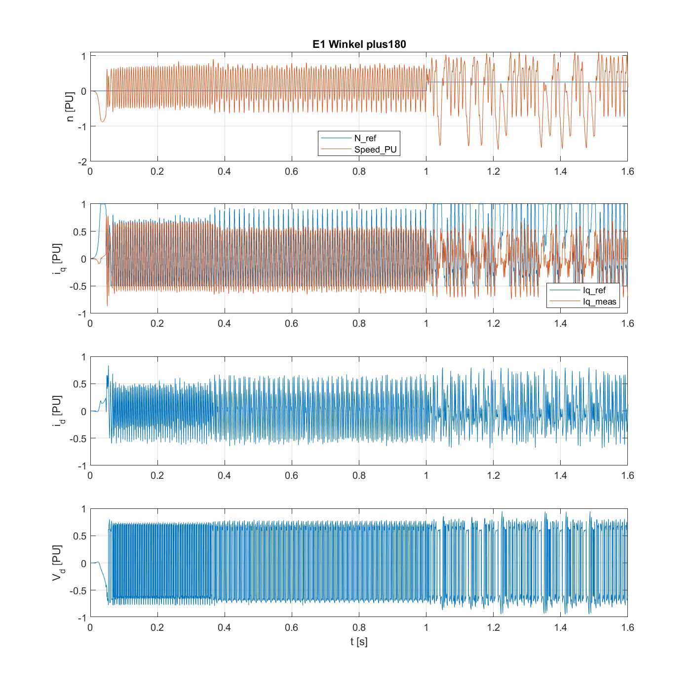
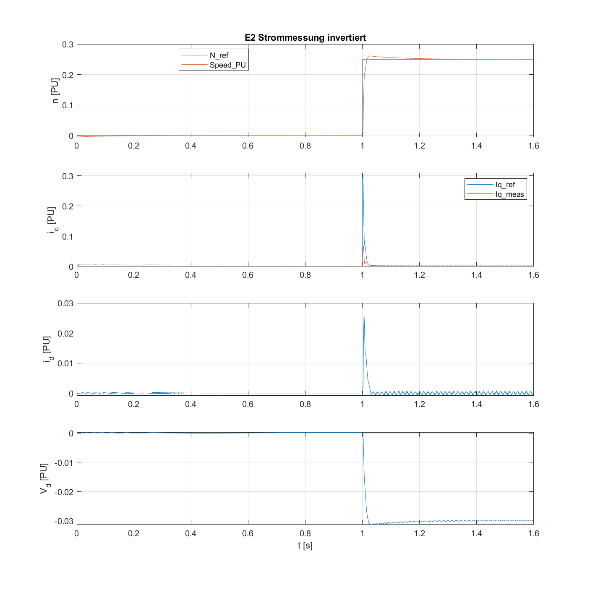
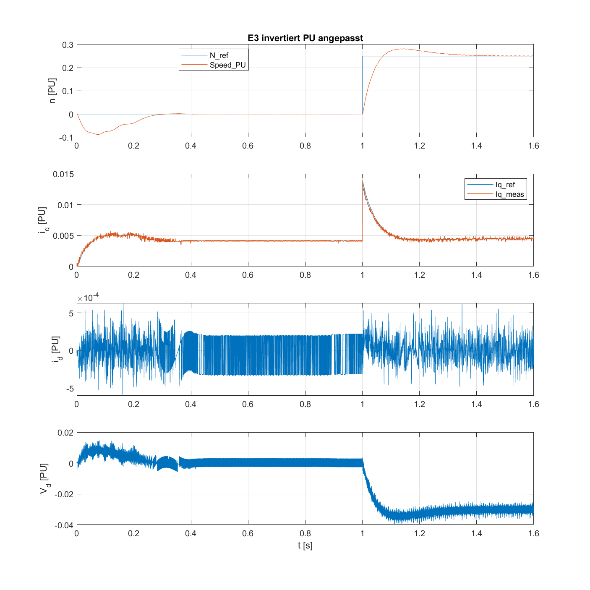

# P1b – Ursache des Grenzzyklus im Stromregler (2026-11-03)

Bezug: [05_P1b_2026-11-03.md](05_P1b_2026-11-03.md). In Lauf B/C schwingt V_d dauerhaft mit ±0,9 PU bei ≈ 325 Hz, `id_err_rms` ≈ 0,23.

**Vorgehen:** Ich habe nur gelesen und gemessen. Das Logging wurde ausschließlich im Speicher gesetzt, jede Simulation dauerte 0,3 s im Stand P1b (Profil `datasheet`), danach wurde ohne Speichern geschlossen. `git status` war nach jedem Lauf sauber. Logs: `06_diag_*.log` (nicht versioniert).

## Ergebnis in einem Satz

**Der Stromregelkreis ist im Simulationspfad mitgekoppelt.** Zwischen Stellspannung und gemessenem Strom liegt eine Phasendrehung von ≈ 180°. Zusätzlich ist die Strom-PU-Skalierung um den Faktor 32 anders als bei der Auslegung angenommen. Die Korrektur `current_pi` hat die Mitkopplung nur **sichtbar** gemacht, nicht verursacht.

## Belege

### 1. Vorzeichen des Regelkreises (Hauptbefund)

Komplexe Regression zwischen den d/q-Größen aus Reglersicht (C) und den d/q-Größen der Strecke (P, Signale `IdSync/IqSync/VdSync/VqSync` des PMSM-Blocks):

| Pfad | Beziehung | Betrag | Drehung | Restfehler |
|---|---|---|---|---|
| Strom | I_C = k·I_P | 560,1 A/PU | **−172,7°** | 4 % |
| Spannung | V_C = k·V_P | 14,7 V/PU | **+7,2°** | 34 % (Begrenzung/Oberschwingungen) |

Bei einem reinen Winkelfehler e müssten Strom- und Spannungspfad um −e und +e gedreht sein. Im Regelkreis hebt sich das dann auf. Hier liegen die Drehungen aber **180° auseinander** (−172,7° gegenüber +7,2°). Wirksam ist also I_C ≈ −G·V_C, das heißt **Mitkopplung**.

Gegenprobe über das Drehmoment: `MtrTrq = −19,79 Nm/PU · Iq_C` (Korrelation −0,96). Erwartet war +19,73 Nm/PU (Kt = 0,0352 Nm/A × 560 A/PU). **Positives i_q aus Reglersicht erzeugt negatives Moment.** Der Betrag stimmt exakt, nur das Vorzeichen ist falsch.

Das Streckenmodell selbst ist plausibel: dI_d/dt ≈ (V_d − R·I_d)/L_eff mit L_eff = 40 µH (Datensatz 38 µH).

### 2. So entsteht der Grenzzyklus

- Mitkopplung → der PI-Regler läuft an seine Grenze (±1, DQ-Limiter ≈ ±0,9). Die Strecke bekommt ±12,5 V an 22,5 mΩ, das ergibt Ströme bis **540 A**. Datenblatt: Spitzenstrom 115 A, Spitzenmoment 4,4 Nm; die Simulation zeigt bis ±15,8 Nm.
- Der simulierte Stromsensor sättigt bei (3,3 V − 1,65 V) / 0,003 V/A ≈ 550 A. Danach fehlt die Rückführung, der Integrator läuft voll, und es entsteht ein Kipp-Grenzzyklus zwischen Stellgrößen- und Sensorbegrenzung.
- Zeitlicher Ablauf: |I_d| der Strecke > 100 A ab t = 51,8 ms, |V_d| > 0,5 ab t = 58,4 ms. Das ist direkt nach dem Ende der ADC-Offset-Kalibrierung.
- **Lauf A** ist dieselbe Mitkopplung, aber gebremst: Untergrenze 0 und ein winziger I-Anteil verhindern das Weglaufen. Deshalb bleibt dort i_q,meas ≈ 0, obwohl i_q,ref = 0,23 ist.

### 3. Skalierung (Befund B4, im Simulationspfad bestätigt)

| Größe | Auslegung (`PU_System`) | gemessen im Simulationspfad | Faktor |
|---|---|---|---|
| 1 PU Strom | I_base = 17,6 A | **559–560 A** (zwei unabhängige Regressionen) | 31,8 |
| 1 PU Spannung | V_base = 20,78 V | **13,85 V** (= U_dc/√3, SVM) | 0,67 |

Der Strompfad rechnet 0,003 V/A (nur Shunt, ohne CSA) → ADC 4095/3,36 V → (Counts − 2047)/2048. `PU_System` kommt im Strom- und Spannungspfad nicht vor. Die wirksame Reglerverstärkung ist deshalb etwa **48-mal kleiner** als ausgelegt (Kp_SI ≈ 0,0054 statt 0,255 V/A). Auch mit richtigem Vorzeichen wäre der Kreis stabil, aber sehr langsam (Durchtritt ≈ 22 Hz statt ≈ 1 kHz).

### 4. Woher die 180° kommen (Vermutung, nicht bewiesen)

- Im Simulationspfad ist der Winkel `Mechanical to Electrical Position` mit festem `mechOffsetIn = 0,38` (mechanische PU) eingestellt. Mal 4 Polpaare ergibt das 1,52, also **0,52 el. PU = 187,2°**. Der gemessene Restwinkel im Spannungspfad (+7,2°) entspricht genau 187,2° − 180°. Der Winkelfehler ist also sehr wahrscheinlich e ≈ 187° (dieser Offset).
- Damit der Kreis netto mitkoppelt, muss es zusätzlich **eine Vorzeichenumkehr zwischen Spannungs- und Strompfad** geben. Phasenstrom (A) → `Iab_PU` hat Steigung +559, und der Selector nimmt die Phasen [1 2]. *Nachtrag nach dem Experiment:* Am wahrscheinlichsten fehlt im Sensormodell die Invertierung des Strommessverstärkers (siehe „Wo die Umkehr sitzt“).
- Diese Struktur stammt unverändert aus `impmodel.slx` (P1a ist bitgleich). **Vermutlich war schon der Simulationspfad der MA mitgekoppelt.** Wegen der Grenzen [0, 1] und der winzigen Verstärkungen ist das dort nicht aufgefallen.
- Der Codegenerierungspfad (Hall-Winkel mit `PositionOffset = 0,411`, echter ADC, invertierender CSA `invertingAmp = 1`) ist **ein anderer Pfad**. Dieser Befund sagt nichts darüber, ob das Vorzeichen auf der Hardware stimmt.

## Experiment zur Bestätigung (nur im Speicher, nichts gespeichert)

Skript: Kopie in `%TEMP%\diag9_exp.m`, Log `06_diag_experiment.log`. Stand P1b, Profil `datasheet`, 1,6 s (Drehzahlsprung 0 → 0,25 PU bei 1 s), Kennzahlen aus 1,28…1,6 s. Strommessung invertiert heißt: `inverter_DRV8300.ISenseVoltPerAmp = −0,003` **nur im Workspace**, das Modell bleibt unverändert.

| Experiment | Änderung | std(V_d) | id_err_rms | iq_err_rms | speed_err | max \|I\| Strecke | Moment/Iq_C | Korr. |
|---|---|---|---|---|---|---|---|---|
| E0 | keine (Referenz P1b) | 0,810 | 0,231 | 0,072 | −0,0002 | 532 A | **−20,9** Nm/PU | −0,90 |
| E1 | Winkel +180° el. (`mechOffsetIn` +0,125) | 0,685 | 0,321 | 0,693 | 0,264 | 517 A | +19,4 | 0,99 |
| E2 | Strommessung invertiert | **0,0001** | **0,0003** | **0,0003** | −0,0005 | **36 A** | **+18,5** | 0,99 |
| E3 | wie E2 + Regler mit wirksamer PU-Basis (559 A / 13,85 V) | 0,0018 | 0,0002 | 0,0002 | −0,0029 | **7,5 A** | +18,2 | 0,95 |

Plots: `img/P1b_diag_E0…E3_*.png`.

| E1 | E2 | E3 |
|---|---|---|
|  |  |  |

Bewertung:
- **E1 bestätigt die Vorhersage:** Eine Winkeldrehung um 180° kehrt nur das Momentvorzeichen um. Der Kreis bleibt mitgekoppelt, weil die Drehung Strom- und Spannungspfad gleich trifft. Der Winkeloffset ist also **nicht** die Ursache.
- **E2 bestätigt die Ursache:** Mit invertierter Strommessung ist der Kreis gegengekoppelt und schwingt sauber ein. Das Moment folgt i_q mit dem richtigen Vorzeichen (+18,5 Nm/PU, erwartet +19,7), die Drehzahl folgt dem Sprung. Der vorhandene Winkeloffset 0,38 passt dann. Wegen der um Faktor ≈ 48 zu kleinen wirksamen Verstärkung folgt i_q,meas der Sollwertspitze beim Sprung aber nur träge (≈ 0,07 statt 0,3 PU).
- **E3:** Mit der Auslegung auf die wirksame PU-Basis (Kp_i = 10,3, Ki_i = 6054 1/s, Kp_speed = 0,038, Ki_speed = 0,30 1/s) folgt i_q,meas dem Sollwert praktisch deckungsgleich. Der Drehzahlsprung hat etwa 12 % Überschwingen, was zur Auslegung mit 5 Hz und Tn = 4/ωc passt. i_d bleibt im Bereich ±3·10⁻⁴ PU (≈ ±0,2 A, ADC-Quantisierung). In 0…0,3 s sackt die Drehzahl auf −0,09 PU durch, weil das Lastmoment (0,1·T_nenn) wirkt, solange der Regler während der Offsetkalibrierung noch nicht arbeitet, und der 5-Hz-Drehzahlregler langsam ausregelt.

### Wo die Umkehr sitzt (eingegrenzt)

- Codegenerierungs- und Simulationspfad rechnen den Strom **gleich** um: `(ADC − Offset)`, `int32` → `fixdt(1,32,17)`, Shift −6. Der Parameter `invertingAmp = 1` wird in keiner der beiden Umrechnungen verwendet.
- Das Sensormodell der Strecke (`Sensor_Measurements`: Strom × `ISenseVoltPerAmp` + 1,65 V → ADC) liefert für Strom **in** den Motor einen ADC-Wert **über** dem Offset.
- ~~Vermutung: CSA invertierend wegen `invertingAmp = 1`.~~ **Korrigiert:** Im Motor Control Blockset (`toolbox/mcb/utils/mcb_SetInverterParameters.m`, R2023a) bedeutet `invertingAmp = 1` „Currents entering motor phases are read as positive values“ und `−1` „… read as negative values“. Der Wert 1 der MA heißt also *nicht invertierend*. Er ist sehr wahrscheinlich der Vorlagenwert und keine Eigenschaft des EVM. Das Sensormodell ist zu dieser Konvention **konsistent**.
- **Damit liegt die Umkehr im Simulationspfad auf der Spannungsseite oder in der Stromrichtungs-Konvention des PMSM-Blocks**, nicht im Sensormodell. E2 (Messung invertieren) wirkt im Kreis gleichwertig, ist aber **nicht** als Ort der Korrektur belegt. Kandidaten (noch nicht geprüft): `PWM Reference Generator` liefert Duty im Bereich −0,93…+0,95, ob `Average-Value Inverter` [0, 1] oder [−1, 1] erwartet; Vorzeichenkonvention der Strangströme des Blocks „Interior PMSM“.

## Nachtrag: Angaben aus SLVUBV6 (DRV8300xxx-EVM User's Guide, April 2020)

Quelle: https://www.ti.com/document-viewer/lit/html/SLVUBV6, Abschnitte 2.1, 2.2 und 2.4 (gelesen am 2026-11-03).

| Angabe | SLVUBV6 | Im Modell (`foc_cfg_inverter_drv8300.m`) |
|---|---|---|
| Shunt | 0,003 Ω (GUI-Tabelle, Punkt 7: „default is 0.003 ohms“) | `Rshunt = 0.003` ✔ |
| CSA-Verstärkung | **10 V/V** (Punkt 8: „hardware resistor, default 10 V/V“) | fehlt, `ISenseVoltPerAmp = 0.003` ✘ (richtig wäre 0,03 V/A) |
| Offset | AREF-Jumper (J8) Standard 1:2 = bidirektional, **1,65 V**; 2:3 = unidirektional 0 V | 1,65 V (2047 Counts) ✔, sofern der Jumper auf der Platine in Standardstellung steht |
| Messbereich | daraus ±1,65 V / 0,03 V/A = **±55 A** | `ISenseMax = 25` (das ist die Überstromschwelle, nicht der Messbereich) |
| Überstrom | Software-Grenze ±25 A in der EVM-Firmware (LaunchPad), PVDD 6–100 V, Sicherung 30 A | `I_trip = 25` ✔ |
| Messstellen | drei CSAs, Low-Side (Produktseite: „three current shunt amplifiers for low-side current measurement“) | Modell liest zwei Phasen (A3: dritte Phase offen) |
| **Polarität** | **nicht angegeben** | `invertingAmp = 1` (Herkunft unklar, im Modell ungenutzt) |

Folgerungen:
- **B4 ist damit quantitativ geklärt** (unter Vorbehalt der Jumperstellung auf der CarPediem-Platine): 1 PU Strom = 2048 Counts × 3,36 V/4095 / 0,03 V/A ≈ **56,0 A** (bei 3,3 V Referenz 55,0 A). Die Auslegung nimmt 17,6 A an. Auf der Hardware wirken die Stromregler damit um Faktor 17,6/56 ≈ 0,31 schwächer, zusammen mit der Spannungsbasis (13,85/20,78) um etwa Faktor 0,21. Das ist langsamer als ausgelegt, aber nicht instabil.
- **Das Sensormodell der Simulation liegt um den Faktor 10 neben der Hardware** (559 A/PU statt 56 A/PU), weil `ISenseVoltPerAmp` nur den Shunt enthält.
- Die Polarität, also ob der CSA bei positivem Phasenstrom (in den Motor hinein) eine Spannung unter oder über 1,65 V liefert, steht nicht im User's Guide.

### Referenzfirmware `DRV8300EVM_Sensored_Trapezoidal_Firmware.zip` (ti.com, heruntergeladen 2026-11-03)

`boostxl_afe031_f28004x_pwmmode_main_DRV8300.c`, Zeilen 205–264:
- `CSAgain = 10`, `OCLIM = 25`, `ISEN_BIDIRECTIONAL = 1` → `CSA_offset = 1.65`
- `ISENx_CURRENT = ((ADC/4095*3.3) − CSA_offset) / SenseResistorValue / CSAgain`
- ADC-Kanäle auf dem **LaunchPad F280049C**: ISENA = ADCINA3, ISENB = ADCINC5, ISENC = ADCINC3 (gilt nicht für die CarPediem-Platine)
- Der Strom wird nur als Betrag ausgewertet (`abs(...) > OCLIM`). Die Firmware legt **keine Stromrichtung** fest. Verstärkung und Offset sind damit bestätigt, die Polarität nicht.

### Schaltplan/Netzliste SLVC817 (Projekt MD029A, Stand 10/26/2020)

Vom Menschen per myTI heruntergeladen (`Downloads/slvc817.zip`). Ausgewertet wurden die IPC-D-356-Netzliste (`Project Outputs/Gerber_NCdrills_IPC/MD029A.ipc`) und die Stückliste (`MD029A(001)_BOM.xls`). Das PDF ließ sich mangels Renderer nicht öffnen; die Netzliste ist dafür maschinenlesbar und eindeutig.

**Bauteile:** Strommessverstärker U7 = **TLV9004IPWR** (4fach-OPV), diskret als Differenzverstärker beschaltet. Die Shunts R49/R50/R63 sind **0,003 Ω**, 1 %, 3 W, Bauform 2512.

**Verschaltung Phase A** (B und C identisch: U7 Kanal 2 bzw. 3, Shunts R50/R63):

| Netz | Verbunden mit | Bedeutung |
|---|---|---|
| MOTA | J5.3, Q2.5–9 (Drain) | Phasenknoten, Q2 = Low-Side-FET |
| SPA | NT1 → Q2.1–3 (Source), R49.2 | **Shunt oben** (FET-Seite) |
| SNA | NT3 → GND, R49.1 | **Shunt unten** (GND) |
| SPA → R71 (10,2 Ω) → R72 (4,99 kΩ) → **U7.3 (IN1+)**, R73 (49,9 kΩ) → J8.2 (Referenz 1,65 V, über U7 Kanal 4 gepuffert, Teiler R100/R101 = 100 k/100 k) | | nicht invertierender Zweig |
| SNA → R69 (10,2 Ω) → R70 (4,99 kΩ) → **U7.2 (IN1−)**, R68 (49,9 kΩ) von U7.1 (OUT1) | | invertierender Zweig, Rückkopplung |
| SOA (U7.1) → R65 (330 Ω) / C36 → **ISENA (J1.18)** | | Ausgang mit RC-Filter |

Verstärkung: G = 49,9 k / (4,99 k + 10,2) = **9,98 V/V**. Das bestätigt die 10 V/V aus SLVUBV6.

Übertragungsfunktion: **U_ISENA = 1,65 V + 9,98 · (U_SP − U_SN) = 1,65 V + 0,0299 V/A · I_Shunt↓**, wobei I_Shunt↓ der Strom von der FET-Source zu GND ist.

**Polarität:** Strom, der **in** den Motor fließt (positiver Strangstrom), kommt während der Low-Side-Leitphase von GND durch den Shunt nach oben, I_Shunt↓ ist also negativ. **Das EVM liefert damit für positiven Strangstrom einen ADC-Wert unter 1,65 V.** In der MCB-Konvention heißt das **`invertingAmp = −1`** („Currents entering motor phases are read as negative values“). Der Wert in `foc_cfg_inverter_drv8300.m` (`+1`) ist für dieses EVM **falsch**. Die Steigung beträgt −29,9 mV/A, der Messbereich ±55 A.

Voraussetzung: Abgetastet wird während der Low-Side-Leitphase (ADC-SOC bei Zählerstand null der ePWM im Up-Down-Modus). Das ist im Codegenerierungspfad noch zu prüfen (Schritt 7).

### Was das für Simulation und Hardware bedeutet

| | Strommessung (Vorzeichen) | Spannungsseite (Vorzeichen) | Kreis |
|---|---|---|---|
| Simulation heute | Sensormodell +1 (nicht invertierend) | enthält eine Umkehr (aus E0/E1/E2 belegt) | **mitgekoppelt** |
| Simulation E2 | −1 (wie EVM) | dieselbe Umkehr | gegengekoppelt, stabil, Moment mit richtigem Vorzeichen |
| Hardware (EVM) | **−1** (Schaltplan) | ? (gemeinsame FOC-Blöcke + ePWM-Konfiguration) | gegengekoppelt, **falls** die Umkehr auf der Spannungsseite in den gemeinsam genutzten Blöcken liegt und nicht nur im Simulations-Wechselrichtermodell |

- **E2 bildet die Hardware-Polarität nach.** Es spricht viel dafür, dass dem Sensormodell der Simulation die (physikalische) Vorzeichenumkehr des EVM fehlt. Das passt dazu, dass die MA auf der Hardware lief, während der Simulationspfad mitgekoppelt war.
- Der Codegenerierungspfad rechnet `(ADC − Offset)` und nutzt `invertingAmp` nicht. Auf der Hardware ist der PU-Strom deshalb ≈ −I_Strang / 56 A.
- Offen ist noch, ob die Umkehr auf der Spannungsseite in Blöcken liegt, die Simulation und Code gemeinsam nutzen (dann ist die Hardware gegengekoppelt), oder nur im Simulationsmodell `Average-Value Inverter` (dann wäre die Hardware mitgekoppelt). Prüfen lässt sich das lesend: Duty-Konvention `PWM Reference Generator` → `Output/CodeGeneration` (Gain `PWM_Counter_Period`) → ePWM-Aktionsqualifizierer (CMPA-Polarität) im Vergleich zu `Output/Simulation` → `Average-Value Inverter`.

### Spannungsseite: Duty-Skalierung, ePWM und Gate-Treiber (gelesen am 2026-11-03, Log `06_diag_pwm.log`, `06_diag_aq.log`)

| Stelle | Befund | Vorzeichen |
|---|---|---|
| `Torque Controller/Scaling DutyCycles` | **beide** Varianten (Sim und CodeGen): `duty = 0,5 − 0,5·PwmRef` (Constant 0,5, Gain −0,5) | **−1, gemeinsam** |
| Simulation: `Average-Value Inverter` | V_Strang = +24 V·(duty − Mittelwert), gemessen in allen drei Phasen | +1 |
| Code: `Output/CodeGeneration` | CMPA = CMPB = duty·5000 (TBPRD), Freemode: WA = 0, WB = 1 | +1 |
| ePWM, Zähler Up-Down | A: CAU = Clear, CAD = Set → A high, solange CTR < CMPA → **High-Side-Duty = duty** | +1 |
| ePWM B | CBU = Clear, CBD = Set → B = A (bei CMPB = CMPA). Totzeit `DBedgeDelay = Positive` (nur RED an A); B läuft laut Freemode-Logik am Totzeit-Modul vorbei | – |
| Gate-Treiber **DRV8300DIPW = Variante DI** (Datenblatt SLVSFG5, Tab. 5 „Device Comparison“) | **GLx invertiert zu INLx**, feste Totzeit 200 ns, Querstromsperre | GL = NOT(B) = NOT(A) → komplementär ✔ |
| ADC-Trigger SOCA | CTR = PRD → A low → Low-Side leitet → Shunt misst richtig ✔ | – |

Die Doku `docs/Firmware-Ueberblick_CarPediem.md` (Zeile 89) bestätigt die invertierten INLx und die Freemode-Logik (WA = 0, WB = 1 → beide Gates aus). Damit hat die Hardware **auf der Spannungsseite dasselbe Vorzeichen wie die Simulation**: die Umkehr in `Scaling DutyCycles`, sonst nicht invertierend.

### Gesamtbild Kreisvorzeichen

| | Spannungsseite | Strecke | Strommessung | Kreis |
|---|---|---|---|---|
| Simulation (heute) | −1 (`Scaling DutyCycles`) | +1 | **+1** (Sensormodell) | **mitgekoppelt** → Grenzzyklus |
| Hardware (Schaltplan + ePWM + DRV8300DI) | −1 (`Scaling DutyCycles`) | +1 | **−1** (EVM, TLV9004-Differenzverstärker) | **gegengekoppelt** |
| Simulation E2 | −1 | +1 | −1 | gegengekoppelt, stabil |

**Ergebnis:** Der Grenzzyklus ist ein **Fehler des Sensormodells in der Simulation** (die Polarität des EVM fehlt). Regler und Codegenerierungspfad sind es nicht. Die Negation in `Scaling DutyCycles` ist in Wirklichkeit die Kompensation der invertierenden Strommessung des EVM. Die Doku der MA erklärt sie mit der Drehrichtungskonvention; das ist nach diesem Befund sehr wahrscheinlich falsch. Dazu passen die beiden Winkeloffsets von ≈ 180° (`mechOffsetIn` 0,38 → 187° el., `PositionOffset` 0,411 → 148° el.): Gleichzeitiges Negieren von Strom und Spannung entspricht einer Drehung des d/q-Systems um 180°.

**Folgerung für die Hardware:** Mit P1b (Grenzen ±1) ist kein Weglaufen durch ein falsches Vorzeichen zu erwarten. **Annahmen, die vor dem ersten geregelten Lauf zu bestätigen sind:**
1. ePWM6A/7A/8A (GPIO10/12/14) liegen auf INHA/B/C und ePWM6B/7B/8B auf INLA/B/C (Hardware-Überblick Zeile 22: „PWM U/V/W (High/Low) GPIO10/11, 12/13, 14/15“).
2. B läuft tatsächlich am Totzeit-Modul vorbei (`DBedgeDelay = Positive`). Prüfbar im generierten Code (`EPwmXRegs.DBCTL.bit.OUT_MODE`, Schritt 7) oder mit dem Oszilloskop an GHA/GLA bei sehr kleiner PVDD.
3. Messung des Vorzeichens: kleinen Gleichstrom in Phase A einprägen (Labornetzteil, Strombegrenzung) und prüfen, dass `Iab_PU(1)` **negativ** wird.

## Folgen

1. **Die Kennzahlen von P1b sind physikalisch nicht aussagekräftig**, weder für B/C noch für A. Die formale Erfüllung der Erwartungstabelle ist Zufall.
2. Für die Hardware (Schritt 8) liefert diese Simulation keine Freigabe für P1b. Der geplante Erstlauf mit P1a + `legacy_f2838` bleibt die richtige Reihenfolge. Das Stromvorzeichen sollte dort zuerst mit sehr kleiner Stromgrenze geprüft werden.
3. Die Reglerauslegung in `foc_design_controllers` ist in sich richtig, nimmt aber eine PU-Basis an, die das Modell nicht verwendet (B4).

## Vorschlag (wartet auf Freigabe; jeweils eigener Schritt mit Skript in `matlab/tools/`, vorher/nachher protokolliert)

1. **Ort der Umkehr im Simulationspfad finden (nur lesen):** Duty-Konvention `PWM Reference Generator` → `Average-Value Inverter` und Stromrichtung des PMSM-Blocks. Erst danach eine Korrektur in focLib als eigener Schritt, P1b-Läufe A/B/C wiederholen (neuer Tag, z. B. `P1b.1`). Unabhängig davon `ISenseVoltPerAmp = 0.03` (3 mΩ × 10 V/V, SLVUBV6) in `foc_cfg_inverter_drv8300.m` setzen. Das ist eine Änderung an `config/`, danach `test_config`.
2. **Hardware-Polarität (aus SLVC817 geklärt):** `invertingAmp = −1` und `ISenseVoltPerAmp = 0.03` in `foc_cfg_inverter_drv8300.m` setzen (`config/`, danach `test_config`). Das Sensormodell der Simulation soll `invertingAmp` berücksichtigen (Gain `inverter_DRV8300.invertingAmp*inverter_DRV8300.ISenseVoltPerAmp`). Ob der Codegenerierungspfad `invertingAmp` braucht, hängt vom offenen Punkt Spannungsseite/ePWM ab; das zuerst lesend klären. Vor dem ersten geregelten Hardwarelauf trotzdem das Vorzeichen mit kleinem Gleichstrom messen.
2. **Skalierung vereinheitlichen (B4):** entweder `PU_System.I_base/V_base` an den Modellpfad anpassen (559 A/13,85 V im Simulationspfad, Hardware erst nach CSA-Verstärkung aus SLVUBV6) oder die Umrechnung im Modell auf `PU_System` umstellen. Danach `foc_design_controllers` neu auswerten.
3. Die Erwartungstabelle in AGENTS.md um zwei Prüfungen ergänzen: Vorzeichen (Moment folgt i_q,ref) und Stabilität (`std(V_d)` klein in den letzten 20 %).
