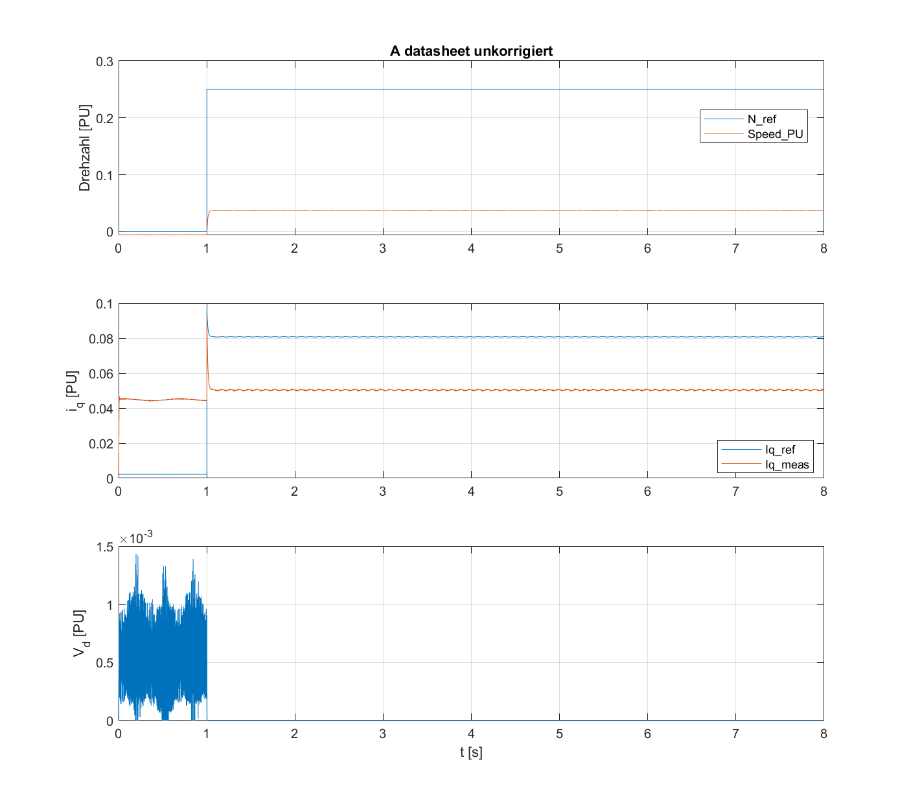
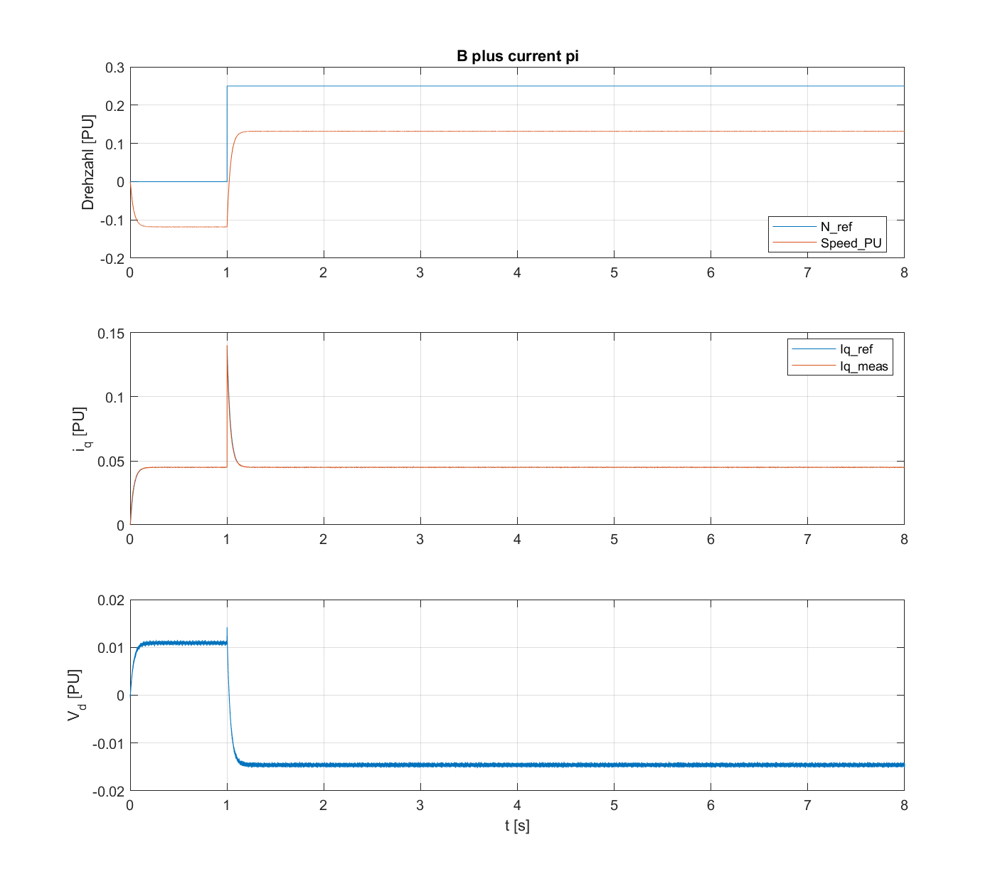
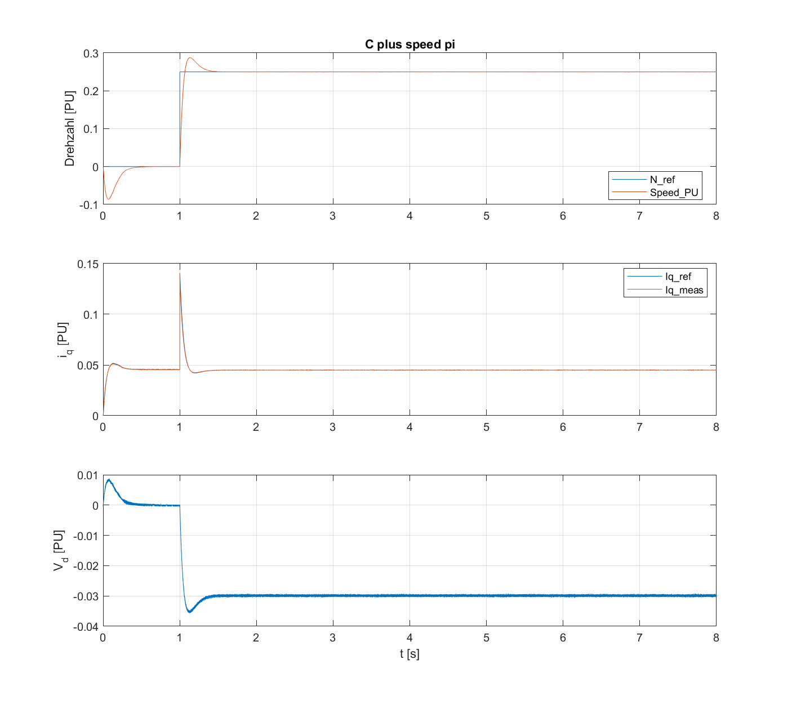

# Schritt 5 (Wiederholung) – P1b.1: Reglerkorrekturen mit korrigierter Messkette (2026-11-03)

Bezug: [05_P1b_2026-11-03.md](05_P1b_2026-11-03.md) (Grenzzyklus) und [05_P1b_Diagnose_2026-11-03.md](05_P1b_Diagnose_2026-11-03.md) (Ursache).

## Änderungen gegenüber P1b (je ein Commit)

| Commit | Änderung | Nachweis |
|---|---|---|
| `4965129` | `foc_cfg_inverter_drv8300.m`: `invertingAmp = −1`, `ISenseVoltPerAmp = 0,03 V/A`, `ISenseMax = 55 A` (SLVUBV6, SLVC817) | `test_config`: ALL PASSED |
| `36fcf58` | `foc_pu_system.m`: I_base = 56,0 A (Strommesskette), V_base = 13,86 V (SVM). Folge: Kp_i 1,031 PU, Ki_i 606 1/s, Kp_speed 0,380 PU, Ki_speed 2,99 1/s; in SI unverändert | `test_config` inkl. I_base/V_base: ALL PASSED |
| `ca35d44` | Modelle auf P1a zurückgesetzt, `foc_fix_sim_sensor`: Gain im Sensormodell = `invertingAmp*ISenseVoltPerAmp` (nur Simulationspfad) | `foc_check_equivalence` (legacy): 12 Signale, Abweichung **0** |

Octave ist auf diesem PC nicht installiert. Die Änderungen in `config/` verwenden nur Arithmetik und Struct-Felder.

## Ablauf

`foc_startup('datasheet'); T = foc_run_p1b` (8 s, Log `05b_P1b_lauf.log`). Ausgangszustand: focLib mit `UseKiTs = on` an allen PID-Blöcken. Danach wendet das Skript `current_pi` und `speed_pi` an; das Protokoll vorher/nachher ist identisch zu P1b.

## Kennzahlen (letzte 20 % = 6,4…8 s, `vd_min` über den ganzen Lauf)

| Lauf | speed_err_mean | iq_err_rms | id_err_rms | vd_min |
|---|---|---|---|---|
| A datasheet, unkorrigiert | 0,2126 | 0,0304 | 0,0433 | 0 |
| B + current_pi | 0,1183 | 0,00018 | 0,00020 | −0,0153 |
| C + speed_pi | 4,8·10⁻⁷ | 0,00017 | 0,00017 | −0,0357 |

Zum Vergleich P1b (mitgekoppelt): `id_err_rms` ≈ 0,23 und `vd_min` ≈ −0,94 in B/C.

## Plots

| A | B | C |
|---|---|---|
|  |  |  |

## Bewertung gegen die Erwartungstabelle (AGENTS.md §5)

| Kennzahl | Erwartung | Ergebnis | ✔/✘ |
|---|---|---|---|
| vd_min A | ≥ 0 (Begrenzung) | 0 | ✔ |
| vd_min B/C | < 0 möglich | −0,015 / −0,036 | ✔ |
| iq_err_rms B | deutlich kleiner als A | 0,00018 statt 0,030 (Faktor 170) | ✔ |
| iq_err_rms C | ähnlich B | 0,00017 | ✔ |
| speed_err_mean A | ≠ 0 | 0,213 | ✔ |
| speed_err_mean B | ≠ 0 | 0,118 | ✔ |
| speed_err_mean C | ≈ 0 | 5·10⁻⁷ | ✔ |
| **Stabilität** (zusätzlich, aus der Diagnose) | keine Dauerschwingung | V_d glatt, i_q folgt dem Sollwert deckungsgleich | ✔ |

Physikalische Plausibilität:
- **A:** Der Stromregler kann wegen der Grenze [0, 1] V_d nicht negativ machen und hat einen praktisch wirkungslosen I-Anteil. i_q,meas (≈ 0,05) bleibt unter i_q,ref (≈ 0,08), und die Drehzahl erreicht nur ≈ 0,04 von 0,25 PU.
- **B:** i_q,meas liegt deckungsgleich auf i_q,ref. Die bleibende Drehzahlabweichung von 0,118 PU passt genau zu reinem P-Verhalten: i_q,Last / Kp_speed = 0,045 / 0,380 = 0,118 (Last 0,1·T_nenn). Vor dem Sprung steht die Drehzahl deshalb auf −0,12 PU.
- **C:** Die Drehzahl folgt dem Sprung mit ≈ 15 % Überschwingen und ist nach ≈ 0,5 s eingeschwungen (Auslegung 5 Hz, Tn = 4/ωc). Am Anfang fällt sie auf −0,09 PU, weil das Lastmoment schon während der ADC-Offsetkalibrierung wirkt.
- **V_d** wird mit der Drehzahl negativ: −0,015 PU bei n = 0,13 PU (B), −0,030 PU bei n = 0,25 PU (C). Das entspricht der Verkopplung u_d ≈ −ω·L·i_q.

**Ergebnis: P1b.1 erfüllt die Erwartungen in der Simulation.**

## Offen / Hinweise für die Hardware (Schritt 8)

- Für den Codegenerierungspfad ändert sich nichts. Die Strommessung des EVM ist nach Schaltplan bereits invertierend; die Negation in `Scaling DutyCycles` kompensiert das (Diagnosebericht).
- Vor dem ersten geregelten Lauf bestätigen: ePWM6A/7A/8A → INH, B → INL; B läuft am Totzeit-Modul vorbei (`OUT_MODE` im generierten Code); Vorzeichen mit kleinem Gleichstrom (`Iab_PU(1)` negativ bei Strom in Phase A).
- Kp_i = 1,03 PU bei Stellgrößengrenze ±1: Bei Stromfehlern über ≈ 1 PU (56 A) geht der Regler in die Begrenzung. Für die Erstinbetriebnahme mit kleiner Stromgrenze spielt das keine Rolle.
- Die Untergrenze des Drehzahlreglers ist −0,5 (Bremsen) → Rückspeisung ins Labornetzteil möglich (offene Aufgabe A2).
