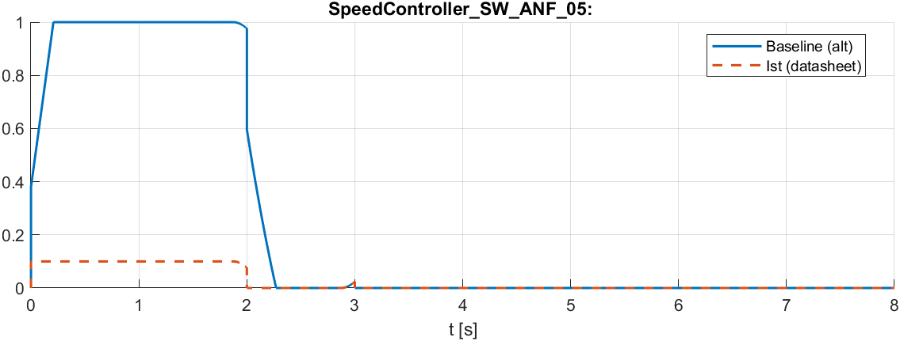

# Schritt 8 / vor S5: Obergrenze des Drehzahlreglers als Parameter `ctrl_limits.Iq_max` (2026-11-04)

Anlass: Codeprüfung P1b.1/`datasheet` (`08_S5_Fehler_Flash_2026-11-04.md`, Befund 1). Der Drehzahlregler war fest auf i_q,ref ≤ 1 PU begrenzt. Mit I_base = 56 A sind das 56 A, mehr als der Motornennstrom (17,6 A) und der EVM-Grenzwert in der Konfiguration (`I_max_hw` 30 A). Entscheidung des Menschen: Parameter einführen.

## Änderungen

| Datei | Änderung |
|---|---|
| `config/foc_config.m` | `ctrl_limits.Iq_max`: legacy **1** (bitgleich), datasheet **0,1 PU ≈ 5,6 A** |
| `tests/test_config.m` | Prüft Iq_max in beiden Profilen und `Iq_max·I_base ≤ I_max_hw`. Iq_max ist in der Liste der vom Modell referenzierten Größen |
| `tools/foc_param_speed_upper.m` (neu) | Setzt im PID-Block `focLib/Speed Control/PI_Controller_Speed/PID Controller` `UpperSaturationLimit = ctrl_limits.Iq_max` (Gegenstück zu `foc_param_brake_limit`, A2) |
| `tools/foc_apply_fixes.m` | `speed_pi` setzt die Obergrenze ebenfalls auf `ctrl_limits.Iq_max` |
| `tools/foc_equivalence_p1a.m` (neu) | Äquivalenzprüfung mit P1a-Reglern nur im Speicher (P/I/UseKiTs/Grenzen aus `impmodel`); beim Drehzahlregler bleiben `Iq_min`/`Iq_max` stehen |
| `models/focLib.slx` | durch `foc_param_speed_upper` |

Ausgabe `foc_param_speed_upper` (Log `08_Iqmax_param.log`):

```
focLib/Speed Control/PI_Controller_Speed/PID Controller
  vorher:  UpperSaturationLimit=1, LowerSaturationLimit=ctrl_limits.Iq_min
  nachher: UpperSaturationLimit=ctrl_limits.Iq_max
focLib gespeichert.
```

## Nachweise

| Prüfung | Ergebnis |
|---|---|
| `test_config` | ALL PASSED |
| `foc_equivalence_p1a` (legacy_f2838, Iq_min −0,5 / Iq_max 1) | 12 Signale, Abweichung **0** (Log `08_Iqmax_equivalence.log`) |
| MIL (datasheet, `foc_run_mil_tests`) | 3/4 bestanden. **SW_ANF_05: alle verify bestanden, Baseline weicht ab** (Log `08_Iqmax_mil.log`) |
| `foc_codegen` (datasheet) | erfolgreich, **kein Laden**; im Code `PIDController_UpperSaturationLi = 13107` = 13107/131072 = **0,1 PU** ✔, Untergrenze 0 ✔ |

## Offen: Baseline SW_ANF_05

Die Baseline `tests/baselines/SpeedController_SW_ANF_05.mat` (P1b.1 + A2) enthält i_q,ref bis **1,0**, die damalige Obergrenze. Mit `Iq_max = 0,1` begrenzt der Regler jetzt auf 0,1. Die Abweichung ist also die beabsichtigte Folge der Änderung. Vorzeichen und Freemode-Logik (verify) sind unverändert in Ordnung.

Vorschlag: Baseline mit `foc_recapture_baseline('SpeedController_SW_ANF_05')` neu aufnehmen. **Nicht ausgeführt, Entscheidung des Menschen.**

### Nachtrag: Baseline angesehen

`foc_plot_baseline_diff('SpeedController_SW_ANF_05')` → `img/MIL_SpeedController_SW_ANF_05_Baseline.png`. Alt: i_q,ref läuft bis 1,0. Jetzt: begrenzt auf 0,1, nach 2 s schneller auf 0 (weniger I-Anteil aufgezogen). Sonst deckungsgleich. Die Abweichung ist erwartet.


